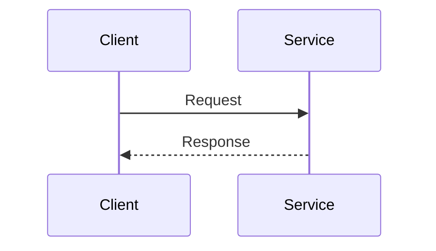

# MkDocs Documentation Reference

Use this reference after the core workflow establishes the audience and documentation scope.

## Repository Shape

```text
docs/
|-- mkdocs.yml
|-- Dockerfile
`-- docs/
    |-- index.md
    |-- getting-started.md
    |-- architecture/
    |-- technical/
    |-- business/
    |-- runbooks/
    `-- external/
```

Keep configuration and Markdown sources in one build context. Add categories only when the project has content that belongs to them.

## Choose The Document Type

| Need | Typical document | Include |
|---|---|---|
| Orient a reader | `index.md` | Purpose, boundaries, structure, key links |
| Enable local use | `getting-started.md` | Prerequisites, startup, endpoints, common setup failures |
| Explain system shape | `architecture/` | Context, responsibilities, dependencies, data ownership, decisions |
| Explain implementation | `technical/` | Backend, frontend, database, authentication, shared packages |
| Explain product behavior | `business/` | Requirements, domain language, invariants, workflows |
| Support operations | `runbooks/` | Deployment, health, failures, recovery, escalation |
| Explain external systems | `external/` | Owned boundary, configuration, compatibility, authoritative links |

Do not create empty standard pages. Add one only when it helps a real reader act or decide.

## Baseline MkDocs Contract

- Use the Material theme and the configured light and dark palettes.
- Keep search enabled.
- Enable Mermaid only through the declared plugin and matching superfence.
- Keep code highlighting, tabs, admonitions, details, attributes, tables, and heading permalinks aligned with `mkdocs.yml`.
- Maintain explicit `nav`; a file existing on disk does not make it discoverable.

Example Mermaid fence:

````markdown

````

Use simple diagram identifiers, reader-facing labels, and a brief textual meaning.

## Container Contract

- Build from a supported slim Python image.
- Install MkDocs, Material, Mermaid, and PyMdown dependencies explicitly.
- Copy `mkdocs.yml` and `docs/` with ownership assigned to a dedicated non-root user.
- Serve on the port expected by local orchestration and reverse proxy configuration.
- Retain a bounded HTTP healthcheck.
- Avoid undeclared bind-mounted workstation files in the production path.

## Common Failure Modes

| Failure | Prevention |
|---|---|
| Page cannot be found | Add it to `nav` and link it from the closest task-oriented page. |
| Prose conflicts with implementation | Treat executable evidence as authoritative and update the page. |
| Mermaid fails | Keep plugin, superfence, and container dependency configuration aligned. |
| Build works only locally | Build only from declared files and dependencies inside `docs/`. |
| Public route is unhealthy | Align container port, healthcheck, proxy target, and documented URL. |
| External page becomes a copied manual | Explain the local boundary and link the authoritative source. |
| Runbook lists tools but no action | Connect each signal to interpretation, response, and recovery. |

